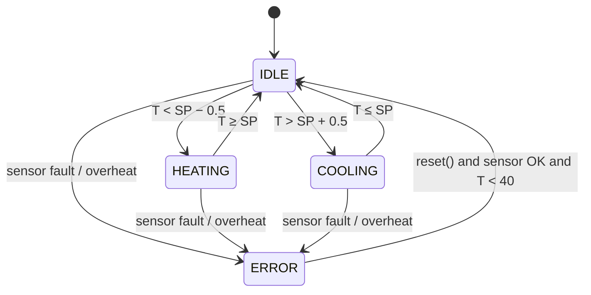

# Thermostat Simulator with Automated Test Suite


A Python simulation of an embedded room thermostat controller, developed **requirements-first**:
15 numbered requirements, a state-machine design, and a pytest suite where every test is traced
back to the requirement it verifies.

## Highlights

- **Requirements-based testing**: 15 testable requirements in [`docs/requirements_spec.md`](docs/requirements_spec.md), each linked to its tests in a traceability table
- **48 automated test cases**, all labelled with their requirement ID; the run fails if any requirement is left untested
- **Simulated time**: tests cover more than a minute of controller behaviour in under 0.1 s, with fully repeatable results
- **Fault injection**: missing sensor readings, out-of-range values, overheating, recovery after reset
- **Boundary value testing** at every threshold (20.4 / 20.5 °C, 39.9 / 40.0 °C, −20.0 / −20.1 °C, …)
- **Mutation-checked**: bugs were deliberately introduced into the controller to confirm the tests catch them
- **CI**: GitHub Actions runs the suite on Python 3.10, 3.12 and 3.14 on every push and publishes an HTML test report

## How it works

The controller follows a PLC-style **scan cycle** every 100 ms: read the sensor → update the state machine → set the outputs.



Key design decisions:

- **Safety checks run before control logic**, so no normal condition can override a fault
- **Hysteresis** (±0.5 °C) and a **5 s minimum off time** prevent rapid on/off switching
- **ERROR is latched**: the controller stays in a safe state (all outputs off) until a manual reset, and the reset is refused while the fault is still present
- **Dependency injection**: the clock, sensor and actuators are passed into the controller, so tests can control time and inject faults

## Project structure

```
src/thermostat/
    clock.py        simulated clock (integer milliseconds)
    sensor.py       temperature sensor with fault injection
    actuators.py    heater and cooler
    controller.py   state machine and scan cycle
tests/
    conftest.py                     fixtures + requirement coverage reporting
    test_startup_and_setpoint.py    REQ-01 to REQ-04
    test_normal_control.py          REQ-05 to REQ-10
    test_fault_handling.py          REQ-11 to REQ-15
docs/requirements_spec.md           requirements, state machine, traceability table
demo.py                             runs a short scenario and prints what happens
```

## Running it

Requires Python 3.10+.

```bash
pip install -r requirements.txt

python -m pytest -v                                       # run all tests
python -m pytest --html=report.html --self-contained-html # also create an HTML report
python -m pytest -k overheat -v                           # run only tests whose name contains "overheat"
```

On Windows, run the demo with `$env:PYTHONPATH="src"; python demo.py`; on Linux/macOS, `PYTHONPATH=src python demo.py`.

At the end of each run, pytest prints a coverage summary:

```
============================= Requirement coverage =============================
REQ-01  PASS        1/1 tests passed
REQ-02  PASS        2/2 tests passed
...
REQ-15  PASS        7/7 tests passed
48 passed in 0.06s
```

## What I learned

- Writing requirements that are precise enough to be tested, and finding gaps in them while writing tests
- Modelling control logic as a state machine and ordering safety checks above normal behaviour
- Why simulated time and dependency injection make timing-dependent code testable
- pytest fixtures, parametrization, custom markers and hooks
- Checking test quality with mutation testing, not just counting passing tests
- Setting up continuous integration with GitHub Actions
