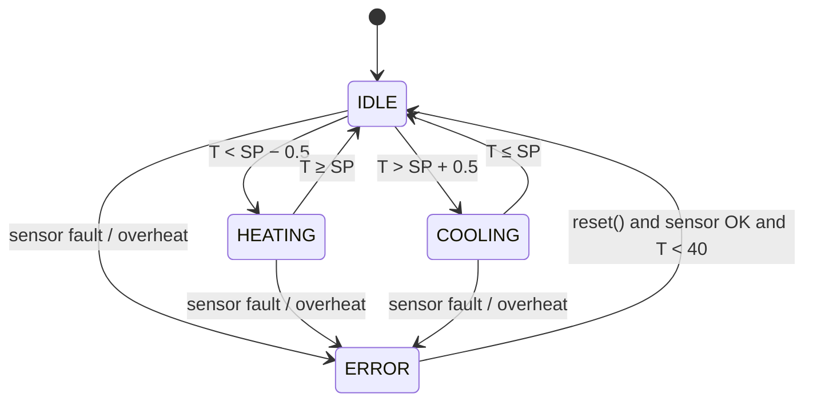

# Thermostat Controller – Requirements Specification

**Project:** Thermostat Simulator with Automated Test Suite
**Version:** 0.1 (draft)
**Author:** Ilkin Panahov

## 1. Purpose

This document defines the required behaviour of a simulated room thermostat controller.
Every requirement has a unique ID and is written so that it can be verified by an automated test.
The test suite references these IDs, and the traceability table (section 6) maps each requirement to its tests.

## 2. System overview

The controller runs a PLC-style **scan cycle**: read the temperature sensor → apply the control logic → set the outputs.

| Component | Description |
|---|---|
| Temperature sensor | Returns the room temperature in °C, or no value if it has failed |
| Heater | Output: ON / OFF |
| Cooler | Output: ON / OFF |
| Controller | State machine with the states IDLE, HEATING, COOLING, ERROR |
| Clock | Simulated time, so tests run instantly and give repeatable results |

## 3. Definitions and parameters

| Name | Value | Meaning |
|---|---|---|
| Scan cycle | 100 ms | Time between two controller cycles |
| Setpoint (SP) | 21.0 °C default | Target room temperature |
| Setpoint range | 10.0 – 30.0 °C | Allowed setpoint values |
| Hysteresis | 0.5 °C | Band around the setpoint that prevents rapid switching |
| Sensor valid range | −20.0 – 60.0 °C | Readings outside this range are invalid |
| Sensor fault limit | 3 cycles | Consecutive invalid readings before ERROR |
| Overheat limit | 40.0 °C | Safety limit |
| Minimum off time | 5 s | Anti-short-cycle protection for heater and cooler |

## 4. State machine

| State | Heater | Cooler |
|---|---|---|
| IDLE | OFF | OFF |
| HEATING | ON | OFF |
| COOLING | OFF | ON |
| ERROR | OFF | OFF |

## 5. Requirements

### 5.1 Startup and timing

**REQ-01 – Startup state**
On startup, the controller shall be in the IDLE state with the heater and cooler both OFF.

**REQ-02 – Scan cycle**
The controller shall execute one scan cycle (read sensor → apply logic → set outputs) every 100 ms of simulated time.

### 5.2 Setpoint

**REQ-03 – Default and adjustable setpoint**
The default setpoint shall be 21.0 °C. The setpoint shall be adjustable to any value from 10.0 °C to 30.0 °C inclusive.

**REQ-04 – Invalid setpoint**
A setpoint outside 10.0 – 30.0 °C shall be rejected, and the previous setpoint shall remain active.

### 5.3 Normal control

**REQ-05 – Start heating**
When in IDLE and the temperature is below (SP − 0.5 °C), the controller shall enter HEATING and switch the heater ON within one scan cycle.

**REQ-06 – Stop heating**
When in HEATING and the temperature reaches or exceeds SP, the controller shall enter IDLE and switch the heater OFF within 2 s.

**REQ-07 – Start cooling**
When in IDLE and the temperature is above (SP + 0.5 °C), the controller shall enter COOLING and switch the cooler ON within one scan cycle.

**REQ-08 – Stop cooling**
When in COOLING and the temperature falls to or below SP, the controller shall enter IDLE and switch the cooler OFF within 2 s.

**REQ-09 – Mutual exclusion**
The heater and the cooler shall never be ON at the same time.

**REQ-10 – Minimum off time**
After the heater or the cooler is switched OFF, it shall not be switched ON again for at least 5 s, even if the temperature condition for switching it ON is met.

### 5.4 Fault handling

**REQ-11 – Sensor valid range**
A sensor reading outside −20.0 – 60.0 °C, or a missing reading, shall be treated as invalid. A single invalid reading shall be ignored, and the controller shall keep using the last valid reading.

**REQ-12 – Sensor fault**
If the sensor returns 3 consecutive invalid readings, the controller shall enter ERROR.

**REQ-13 – Overheat protection**
If the temperature reaches or exceeds 40.0 °C, the controller shall enter ERROR and switch the heater OFF within one scan cycle.

**REQ-14 – Safe state**
In ERROR, the heater and the cooler shall both be OFF. The controller shall stay in ERROR until a manual reset, even if the fault disappears.

**REQ-15 – Reset**
A reset shall return the controller to IDLE only if the current sensor reading is valid and below 40.0 °C. Otherwise the controller shall stay in ERROR.

## 6. Traceability table

To be filled in once the tests are written.

| Requirement | Test(s) | Status |
|---|---|---|
| REQ-01 | | |
| REQ-02 | | |
| REQ-03 | | |
| REQ-04 | | |
| REQ-05 | | |
| REQ-06 | | |
| REQ-07 | | |
| REQ-08 | | |
| REQ-09 | | |
| REQ-10 | | |
| REQ-11 | | |
| REQ-12 | | |
| REQ-13 | | |
| REQ-14 | | |
| REQ-15 | | |
